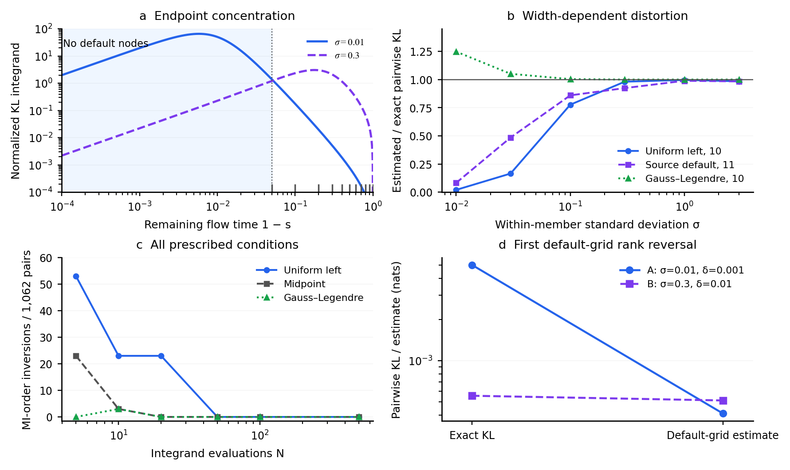

# Flow 不确定性分数：有限网格与拟合误差的边界

2026-11-15。**本轮得到可复核的测量机制线索，但没有确定研究方向、提出新算法或证明真实 VLA 风险损害。**
完整目标仍是找到有实质查新增量、可实现并能在 SO-101 仿真—真机检验同一命题的方向。
本轮不重启已停止的小 BC 调参。

后续版本/资产核查已完成：[VFD后续裁决](../vfd-assets-20261115/README.md)。
新近邻进一步约束路径代理的一般原理；公开记录仍缺合格ensemble与任务决策损害。
因此当前线索已移出主推荐。以下保留原四阶段结果及当时的判断，不改写原始输出。

## 现在可以说什么

在 [UQ-VLA v1](https://arxiv.org/html/2606.18043v1) 所用的 Gaussian OT 人口最优场中，
连续加权速度场分歧与 pairwise KL 的恒等式通过独立解析/自适应积分检查。
有限时间网格则可以改变分布分歧排序；公开默认评分组件在预先指定48条件上产生20个明确MI次序反转。

进一步，终点相同的中间路径偏差也会产生正VFD，并在本构造中随积分靠近终点发散。
这组偏差场不满足精确OT人口最优场条件，**不推翻原文的连续定理**。
它提示实际拟合/数值误差与认知不确定性不能自动画等号。

但两项强对照限制了立项：普通Gauss–Legendre20点已消除第一组排序反转；
同一数据的两参数模型充分优化后分歧降至约1e−30量级。不能只展示反例，隐去这些结果。

## 一手来源、实现与先后关系

固定 `learnsyslab/uq_vla` revision `bcc2433d2549afee27bf5d0a73ae528375bca686`。
直接读取默认配置及原始 `InterVelDiff`、`OTCondProbPath`、`select_ode_states` 定义，
以未改写的AST定义配解析适配器在CPU float64调用；不是完整库、检查点或VLA复现。
配置默认评分时间实际为 `0,.1,…,.9,.95`，共11个节点，按各自间隔dt求积。
不能将它混称原文均匀10点。根许可Apache-2.0已读取；原源码留忽略目录，不复制进本项目代码。

依次冻结/执行的计划和完整输出：

| 阶段 | 执行前设计 | 完整结果 | 解释 |
|---|---|---|---|
| 精确高斯条件 | [PLAN.md](PLAN.md) | [analytic-results.json](analytic-results.json) | 48种确定性条件，非48个episode |
| 人为有限拟合偏差 | [PLAN-boundary-fit.md](PLAN-boundary-fit.md) | [boundary-fit-results.json](boundary-fit-results.json) | 6个预定ε，末端map严格相同 |
| 独立有限数据回归 | [PLAN-finite-data.md](PLAN-finite-data.md) | [finite-data-results.json](finite-data-results.json) | 72模型对/144个两参数OLS拟合，成员数据不同 |
| 同数据不同初始化 | [PLAN-same-data.md](PLAN-same-data.md) | [same-data-results.json](same-data-results.json) | 72数据池/144个拟合，三个固定终点共216记录 |

后续阶段是前一阶段结果触发的适应性诊断，不写成四个全部预注册的确认实验。
初始边界检查的quad绝对容差超过微小积分值，程序明确失败、未写正式结果。
[诊断记录](numerical-check-diagnostic.json)保留；随后独立积分单位ε再缩放，不删除条件或放宽理论断言。

## 1. 有限网格反转

两个末端分布为 `N(−δ/2,σ²)` 和 `N(+δ/2,σ²)`，σ取6值、δ取8值，全部48条件保留。
连续pairwise KL=`δ²/(2σ²)`；epistemic MI是两分布的等权Jensen–Shannon divergence，
用独立混合熵积分求参考值，**没有将pairwise KL本身当成MI**。

| 分数/求积 | 明确MI次序反转 / 1,062个可排序条件对 | 最大KL相对误差 |
|---|---:|---:|
| 原文均匀左10点 | 23 | 97.94% |
| 固定源码默认11点 | 20 | 91.75% |
| 传统中点10点 | 3 | 85.19% |
| 传统Gauss–Legendre10点 | 3 | 24.79% |
| 传统Gauss–Legendre20点 | 0 | 2.00% |
| 原文均匀左50点 | 0 | 59.42% |

这些条件对彼此依赖，不是1,062个独立重复，不计算伪重复p值。
48条件网格是执行前设计，并非真实策略输出宽度的经验分布；最大误差受本次σ范围限制。
排序正确也不保证绝对数值准确，反之不能只用分数缩放来解释所有次序改变。
传统求积仅匹配被积函数调用数，未匹配真实神经ODE状态获取的NFE或时延。

原始源码评分与独立公式最大差`1.14e−13`，连续恒等式误差除以`1+KL`最大`6.97e−16`。
相同σ的两高斯均值差使速度差与noise无关；本例增加noise采样不会修复时间求积误差。



图a显示终点集中的积分质量，b展示σ相关缩放失真，c保留全部网格与传统对照，
d按结果文件中的第一个字典序反转展示解释性例子（事后选图规则，不作独立确认）。
图d比较的是pairwise KL，不将MI画成同量纲估计目标。
[SVG](../../../.research/figures/vfd_grid_analytic_20261115.svg) /
[PDF](../../../.research/figures/vfd_grid_analytic_20261115.pdf)；
图合同/数据hash在[figure_plan](../../../.research/figures/figure_plan.md)和
[manifest](../../../.research/figures/source_data_manifest.json)。

## 2. 终点相同的有限拟合偏差

标准高斯末端的精确场为 `v*=(2s−1)x/a(s)`，其中 `a=(1−s)²+s²`。
构造 `v±=v*±ε(s−1/2)`，精确轨迹的均值偏移为`±ε[a−sqrt(a)]/2`，起止均为0。
因此末端sample map逐noise相同，真实KL/MI均0；单成员人口CFM excess MSE=`ε²/12`。

ε=.1时，默认分数为`.01270468`、均匀500点为`.04463487`，真实KL仍为0。
对任意固定ε>0，该代理积分在终点发散；这不是“增加求积点就必然更接近真实KL”的情形。
中心差分、精确截断积分与harmonic-sum离散和均核验。ε从1e−6到1的所有条件都保留，
不隐去小ε对应的绝对分数也很小这一点。

## 3. 普通有限数据拟合与同数据收敛对照

两参数模型 `v_c=v*+c0+c1(s−1/2)` 中，末端分布为 `N(Kc0,1)`，
`K=sqrt(2)asinh(1)`。c1改变中间路径但不改变终点。
以普通CFM样本和最小二乘拟合c0/c1，固定n=256/1024/4096，24对/组。
原始VFD相对真实KL分别出现95/276、75/276、99/276个次序反转。
oracle只删除c1、保留同一c0时反转均0；这是已知分解的诊断上界，**不是可部署的新算法**。
原始source与独立公式误差最大5.55e−17；ODE/末端参考由独立公式核验。

这一阶段成员使用独立数据，不能冒充原VFD的同数据ensemble。因此又做了同数据、
仅不同初始化的普通全批梯度下降，全部三个更新终点均报告：

| 固定更新数 | 各n组的中位真实KL范围 | 中位VFD范围 | 结论 |
|---|---:|---:|---|
| 32 | 1.69e−9–4.83e−9 | 1.96e−5–6.29e−5 | 两参数场中有明显比例失真，但绝对量很小 |
| 128 | 2.57e−15–7.48e−15 | 3.46e−11–1.05e−10 | 差异随优化下降，不声称任务后果 |
| 512 | 0–8.78e−36 | 7.36e−35–1.44e−33 | 基本收敛到同解，分歧消失 |

这是已知人口速度基底上的两参数回归，不能称真实神经VLA训练、推断论文模型的误差大小，
也不能用近机器精度的排序制造实际损害。该对照明确支持保留“充分优化即可解决”的简单解释。

## 查新与下一步 go/no-go

本轮Scholar请求429，未读到结果列表；[SciSpace](scispace-discovery.json)只用于发现，
关键判断回到原文。主要近邻：

- [UQ-VLA §4/A.2](https://arxiv.org/html/2606.18043v1)：已有速度场分歧、连续恒等式及有限网格；不能重新提出VFD。
- [MMG §4.1](https://arxiv.org/html/2509.20609v1)：已有数据适应的重要性采样来估计信息积分；换log-SNR/采样位置不直接算创新。
- [MINDE §3.1](https://arxiv.org/html/2310.09031v2)：已有扩散KL/MI积分及数值估计；分布信息测量不是空白。
- [FM Geometry §3.2、附录C/D.3](https://arxiv.org/html/2607.27933v1)：已经明确讨论终点数值污染、prefix规避和仅局部/精确场的保证；“去掉后几步”已有直接近邻。
- [On Flow Matching KL Divergence §3](https://arxiv.org/html/2511.05480v1)：已有一般速度差与score差内积的有符号KL演化、拟合误差界；改回有符号恒等式也不能当新原理。

有界阅读范围/hash见 `primary-sources.json`、`classical-neighbors.json`、`finite-fit-neighbors.json`。
新邻仓库只核metadata/tree，未声称复现。上述近邻不等于某篇已完整覆盖本例；
它们排除了通用重求积、prefix截断、加校准器或有符号积分作为当前核心。

进一步对FM Geometry固定`1cb8af4`定向读取README/data说明、accel wrapper/prefix probe和根许可，
记录在[geometry-implementation-sources.json](geometry-implementation-sources.json)。
源码已明确警告逐chunk自归一化与固定示范标准差会得到不同分数，需保持相同尺度；
不能把错用默认normalizer制造的差异当科学机制。其权重和数据目录不受版本管理，
本轮没有取得可绑定的真实rollout与模型权重，不称现成SO101/VFD载体。
本页上文“只核metadata/tree”针对`neighbor-code-metadata.json`的初始核查；
此处是之后另行保存的5份文件读取，并未执行上游代码。

**当前裁决：保留“路径拟合误差污染epistemic代理”的机制线索，暂不立项、不实现新方法。**
下一项有资格改变判断的证据必须满足：

1. 同数据、不同训练seed的真实learned flow ensemble中，分歧偏差超过传统时间网格、
   更多优化、相同预算endpoint样本距离/energy distance/MMD、普通校准等强对照；公开模型本身先有任务能力。
2. 冻结动作生成器，只改变评分协议，在held-out初态的示教选择或转交中造成可重复代价；
   不把数值KL反转直接叫风险反转，也不因评分引入额外节点而偷偷改变实际策略动作。
3. SO-101仿真/真机使用同一固定模型、评分和干预语义；需要取得可执行任务的匹配观测与结果，
   没有实机或合格载体时不声称同题可行已验证。
4. 若简单强对照解决，降为评测/诊断工具；不为保留题目重新包装一个模块组合。

当前没有真实VLA ensemble、主动示教收益、失败转交收益或真机结果。
这条问题比单纯关键词空白更具体，但尚未跨过查新、实际任务价值与可行性三道门槛。

## 复核与保存范围

[verification.json](verification.json)记录四份结果在全新路径重跑后逐项一致、20份一手缓存hash、
17个本地文档链接、图数据/脚本hash及三份受保护TPSC原始文件hash。Ruff通过，PNG已实际打开检查。
冻结计划中的一处“系数乘以括号项”的代数写法被简单链接正则误认，已在核查JSON单列排除；没有改写执行前计划。
其正确数学含义为系数乘以`x−sμ`，独立脚本用显式乘法。

四个脚本均需含torch/NumPy/SciPy的既有`tpsc-policy`环境，使用CPU；`--out`必须为新文件。
例如：

```bash
/home/mary/.cache/cogcal/venvs/tpsc-policy/bin/python \
  experiments/discovery/vfd-quadrature-20261115/run_probe.py \
  --out /tmp/vfd-grid-recheck.json
```

`probe_boundary_fit.py`、`probe_finite_data.py`和`probe_same_data.py`用相同方式分别复核后续阶段。
源码缓存缺失或hash不符时明确失败，不自动取上游新版本。
